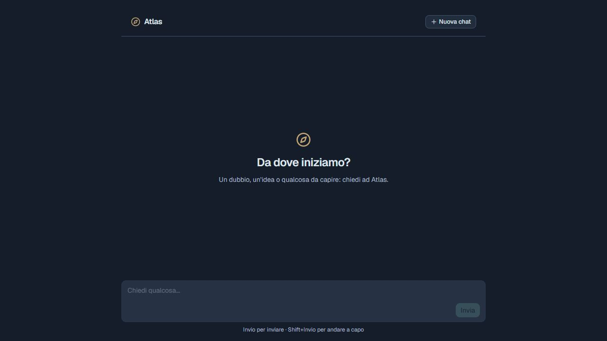

# Atlas — assistente AI locale

Il progetto contiene il backend Node.js per un assistente Ollama locale. Il frontend React / Next.js è nella cartella `frontend`, accanto a `backend`.

Per avviare frontend e backend insieme, vedere [Avvio con Docker Compose](#avvio-con-docker-compose).

Il progetto nasce come esercizio per imparare a costruire un frontend per applicazioni AI, collegandolo a un modello locale senza API a pagamento.

**Progetto di apprendimento in sviluppo**, pensato per essere eseguito sul proprio computer. Le risposte sono generate da Ollama; il tool meteo richiede Internet e invia la città richiesta a Open-Meteo.



## Stato attuale

- Chat con messaggi utente e assistente, gestiti con Redux Toolkit.
- Cronologia salvata in SQLite, con sidebar responsive per creare, riaprire ed eliminare conversazioni.
- Risposta dell'assistente in streaming, aggiornata progressivamente nella chat.
- Bolla temporanea con puntini animati durante la generazione e invio disabilitato durante l'attesa.
- Banner di errore richiudibile.
- Tool MCP per conoscere l'ora e il meteo.

La chat usa le API conversazioni del backend tramite il BFF Next.js. Le conversazioni possono essere riaperte dalla sidebar dopo un refresh; ogni turno viene salvato al completamento della risposta. Il titolo deriva dalla prima domanda. Markdown e annullamento della generazione sono ancora da implementare.

## Architettura

```text
Browser / chat Next.js (:3000)
  → /api/conversations sul BFF Next.js
  → /api/conversations sul backend Node.js (:3001) → SQLite
  → Ollama e tool MCP
```

Il browser chiama il BFF sulla stessa origine. L'indirizzo del backend è configurato sul server Next.js tramite `BACKEND_URL`.

```text
Atlas-locale/
  backend/    # API Node.js, tool MCP, configurazione e test
  frontend/   # Chat Next.js, stato Redux Toolkit e BFF
```

## Avvio backend

Prerequisiti: Node.js 22.13 o successivo, npm e Ollama con il modello indicato nella configurazione del backend. Consultare [backend/.env.example](backend/.env.example) per le variabili disponibili.

Installare il modello predefinito con `ollama pull qwen3:14b`. Verificare di avere risorse sufficienti per eseguirlo, oppure configurare un altro modello che supporti i tool.

Ollama deve essere in esecuzione. Se non è già avviato tramite l'app, aprire un terminale separato:

```sh
ollama serve
```

Eseguire dalla cartella principale:

```sh
cd backend
npm ci
npm run dev
```

L'API ascolta su `http://127.0.0.1:3001`. Avviare Ollama separatamente per generare risposte. Per la versione terminale usare `npm run dev:cli` dalla cartella `backend`.

Per personalizzare la configurazione, copiare `backend/.env.example` in `backend/.env` prima dell'avvio. Senza questo file, il backend usa i valori predefiniti dell'esempio.

## Frontend

Prima dell'avvio, copiare `frontend/.env.example` in `frontend/.env.local`: la variabile `BACKEND_URL` è necessaria per collegarsi al backend. Aprire un altro terminale nella cartella principale `Atlas-locale` e avviare il frontend:

```sh
cd frontend
npm ci
npm run dev
```

Il frontend usa la porta 3000 e il backend la porta 3001. Per un nuovo checkout, eseguire `npm ci` nella cartella `frontend`. Configurare `frontend/.env.local` con `BACKEND_URL=http://127.0.0.1:3001` e riavviare il frontend dopo le modifiche alla configurazione.

Aprire [http://localhost:3000](http://localhost:3000) nel browser. Non aggiungere `frontend/.env.local` al repository.

## Verifica e problemi comuni

- `GET http://127.0.0.1:3001/api/health` permette di controllare lo stato di Ollama e del modello. HTTP 200 indica che il backend è raggiungibile: controllare anche i campi `status` e `ollama`.
- In caso di errore 502, verificare che Ollama sia avviato e che il modello configurato sia installato.
- Nel pannello Network del browser compare la richiesta a Next.js `/api/chat`; la chiamata da Next.js a Node avviene sul server.

Controlli backend, dalla cartella `backend`:

```sh
npm run typecheck
npm test
npm run build
```

Controlli frontend, dalla cartella `frontend`:

```sh
npm run lint
npm run build
```

## Dati e uso locale

L'API backend ascolta sul loopback e non ha autenticazione: è pensata per uso locale, non per essere esposta su Internet. Rendere pubblico il codice non richiede di pubblicare un'istanza dell'applicazione.

Non aggiungere a Git credenziali, conversazioni o dati personali. Il server sperimentale dei promemoria salva in `backend/data/reminders.json`; questa cartella è esclusa dal repository. I promemoria non sono collegati alla chat web attuale.

## Licenza

Il codice originale di Atlas è distribuito con licenza [ISC](LICENSE). Le dipendenze e il modello Ollama utilizzato mantengono le rispettive licenze.

## Prossimi passi

- Pulsante Stop per annullare la generazione.
- Rendering Markdown e blocchi di codice.

Il contratto API e le istruzioni dettagliate sono in [backend/README.md](backend/README.md). Le specifiche precedenti sono conservate in [backend/specifiche-atlas-locale.md](backend/specifiche-atlas-locale.md); i loro percorsi si riferiscono alla cartella backend.

## Avvio con Docker Compose

Docker Desktop deve essere avviato in modalità container Linux. Dalla root del repository:

```sh
docker compose up --build
```

Aprire [http://localhost:3000](http://localhost:3000). Per avviare in background usare `docker compose up --build -d`; per arrestare frontend e backend usare `docker compose down`. L'avvio attende il controllo di salute del backend. Questo controllo conferma che l'API risponde; Ollama può risultare `unavailable` o `model_missing` senza impedire di aprire l'interfaccia e la cronologia.

Compose avvia **frontend e backend**; Ollama resta sul PC, con il modello già installato e l'accelerazione configurata. Avviare Ollama prima di fare domande. Non occorre eseguire `npm ci` sul PC né creare i file `.env` nelle cartelle frontend/backend.

- Frontend: unica porta pubblicata, `127.0.0.1:3000`.
- Backend: raggiungibile dal frontend come `http://backend:3001`, senza pubblicare la porta sul PC. `HOST=0.0.0.0` è impostato solo nel container; l'avvio Node locale mantiene `127.0.0.1` come default.
- Ollama: raggiunto dal backend tramite `http://host.docker.internal:11434`. Il mapping `host-gateway` supporta anche Docker Engine Linux, dove Ollama deve ascoltare su un'interfaccia raggiungibile dal bridge.
- SQLite: `/app/data/atlas.db`, nel volume Docker `atlas-data`. Il volume mantiene le chat dopo `down`, riavvii e ricostruzioni delle immagini. Il file `backend/data/atlas.db` dell'avvio locale non viene importato automaticamente: i due ambienti hanno dati separati.
- I container eseguono build di produzione come utente `node`, senza dipendenze di sviluppo a runtime. I tool MCP vengono avviati dal JavaScript compilato.

### Personalizzazione e Ollama

Le opzioni sono in [.env.example](.env.example). Per cambiarle, copiarlo in `.env` **nella root**; Compose lo legge automaticamente. Per esempio, `FRONTEND_PORT=3002` evita un conflitto con un frontend già avviato. I file `.env` nelle cartelle applicative non vengono caricati nei container.

Se Ollama non è raggiungibile dal container, controllare che accetti connessioni dall'interfaccia Docker. Ollama usa normalmente `127.0.0.1:11434`; la variabile `OLLAMA_HOST` controlla l'indirizzo di ascolto. Su Windows modificare la variabile d'ambiente e riavviare l'app Ollama; per un avvio manuale PowerShell, dopo aver chiuso l'app:

```powershell
$env:OLLAMA_HOST = '0.0.0.0:11434'
ollama serve
```

Questa impostazione allarga l'ascolto di Ollama: limitare tramite firewall l'accesso alle reti necessarie. L'URL usato da Atlas si configura separatamente con `OLLAMA_BASE_URL` nel `.env` della root. Indicazioni ufficiali: [configurazione Ollama](https://docs.ollama.com/faq).

### Dati e diagnostica

```sh
docker compose ps
docker compose logs -f backend frontend
docker compose exec backend node -e "fetch('http://127.0.0.1:3001/api/health').then(r=>r.json()).then(console.log)"
```

`docker compose down` conserva le conversazioni; **`docker compose down -v` elimina anche il volume e tutte le chat Docker**. Per copiare il database a backend fermo:

```sh
docker compose stop backend
docker compose cp backend:/app/data/atlas.db ./atlas-backup.db
docker compose start backend
```

La prima build richiede Internet per le immagini Node, le dipendenze npm e i font Google. Le modifiche al codice richiedono `docker compose up --build`; non è una configurazione con hot reload. La comunicazione fra servizi usa la rete Compose: [documentazione Docker](https://docs.docker.com/compose/how-tos/networking/).

Verifiche Docker eseguite: build di entrambe le immagini, healthcheck, tool MCP compilati, flusso browser → Next.js → backend → Ollama simulato, streaming e persistenza SQLite dopo ricreazione dei container. L'Ollama reale sul PC non era raggiungibile durante la verifica.
